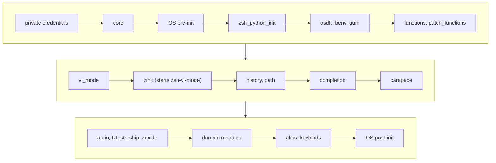

# My custom `dotfiles`

Personal dotfiles for macOS (primary), WSL2, Linux, Termux and Windows.
[chezmoi](https://www.chezmoi.io/) manages them.

## Quick start

On macOS, Linux or WSL2:

1. Install chezmoi.
2. Run these commands:

   ```sh
   mkdir -p ~/workspace/jack06215
   git clone https://github.com/jack06215/dotfiles ~/workspace/jack06215/dotfiles
   chezmoi init --apply --source ~/workspace/jack06215/dotfiles
   ```

3. Run the setup script. It installs Homebrew, the packages and the asdf
   toolchains, then applies the dotfiles again:

   ```sh
   ~/setup.sh
   ```

4. Open a new terminal session.

`setup.sh` supports macOS on arm64, Debian 12 and 13, and Ubuntu 22.04, 24.04
and 26.04 (WSL2 included). If a step fails, the script continues and lists the
failed steps at the end.

For the other platforms, do the steps in these guides:

- Windows: [`docs/windows-setup.md`](docs/windows-setup.md)
- Termux: [`docs/termux-setup.md`](docs/termux-setup.md)

## How it works

- **Machine data.** `chezmoi init` renders
  [`.chezmoi.toml.tmpl`](.chezmoi.toml.tmpl) into
  `~/.config/chezmoi/chezmoi.toml`. The template records the OS, the
  architecture, WSL2 and `IS_COMPANY_MACHINE`. It also reads per-machine paths
  from [`.chezmoidata/lookups.toml`](.chezmoidata/lookups.toml). Templates read
  the result as `.myComputer.*`, `.wsl.*`, `.xdg.*` and other keys.
  [`.chezmoiignore`](.chezmoiignore) uses the same data to skip files that do
  not apply to the machine. The template also finds the Windows home and the
  paths of the Windows apps (WSL2).

> [!IMPORTANT]
> Only `chezmoi init` sets the machine data. After you edit
> `.chezmoi.toml.tmpl` or `lookups.toml`, run `chezmoi init` again.
> `chezmoi apply` warns when the template changed.

- **XDG Base Directory.** [`dot_zshenv.tmpl`](dot_zshenv.tmpl) sets the base
  directories from the
  [XDG Base Directory Specification](https://specifications.freedesktop.org/basedir-spec/basedir-spec-0.8.html)
  version 0.8.
  It also points cargo, go, npm, poetry, docker, gnupg, git, rustup and other
  tools at them. These settings keep `$HOME` clean. The
  [Arch wiki](https://wiki.archlinux.org/title/XDG_Base_Directory) lists the
  variable that each tool needs.
- **System Settings (macOS).**
  [`.chezmoiscripts/run_onchange_after_macos-defaults.sh.tmpl`](.chezmoiscripts/run_onchange_after_macos-defaults.sh.tmpl)
  writes the System Settings values with `defaults`. Then it restarts the Dock,
  Finder and ControlCenter. To track one more setting, add a `defaults write`
  line to the script. Trackpad, mouse and input-source settings apply only
  after the next logout. The accessibility settings need Full Disk Access for
  the terminal.
- **Windows config (WSL2).** Windows apps (WezTerm, GlazeWM, Zebar, VS Code,
  Firefox, Windows Terminal, PowerShell) read their config from the Windows
  home. `chezmoi apply` in WSL does not write there. When one of these files
  changes,
  [`.chezmoiscripts/run_onchange_after_push-windows-configs.sh.tmpl`](.chezmoiscripts/run_onchange_after_push-windows-configs.sh.tmpl)
  copies it to the Windows home. If the Windows copy is different from the last
  copy that the script wrote, the script first saves it as
  `<name>.chezmoi-backup-<timestamp>`.

## Layout

The tree lists only the paths whose names do not say what they hold. The
GitHub file list shows the other paths.

```text
.
├── .chezmoi.toml.tmpl      machine data template
├── .chezmoidata/           lookup tables
├── .chezmoitemplates/      lookup helpers
├── .chezmoiscripts/        run_ scripts
├── dot_zshenv.tmpl         ~/.zshenv (XDG, tool env, ZDOTDIR)
├── dot_tool-versions.tmpl  asdf toolchain (mise on Windows)
├── dot_config/
│   ├── claude/             Claude Code config + skills/ → ../../skills
│   ├── tock/               time tracker
│   ├── private_pet/        snippets (zsh + nushell)
│   ├── private_navi/       cheatsheets (zsh + nushell)
│   └── windows-terminal/, powershell/   (Windows)
├── dot_local/
│   ├── bin/                zshfn (zsh functions as commands) + clipboard shims
│   └── share/              tool data (tock, gnupg, lynx, posting)
├── dot_glzr/               GlazeWM + Zebar (Windows)
├── dot_orca/               Orca keybindings
├── dot_termux/             app config + Termux:Boot scripts (Termux)
├── keyboards/              HHKB Studio keymaps, imported by hand (repo only)
└── Library/                launchd agent for the ollama service (macOS)
```

Files for repository maintenance:

| Path | Purpose |
| --- | --- |
| [`Brewfile.tmpl`](Brewfile.tmpl), [`brewfiles/`](brewfiles/) | Homebrew manifests, one for each OS (macOS, WSL2). `Brewfile.tmpl` renders the applicable one to `~/Brewfile`. |
| [`pkgfiles/termux`](pkgfiles/termux) | The package manifest (Termux). |
| [`tools/termux-docker/`](tools/termux-docker/) | A Dockerfile that builds the Termux setup as an image for a PC. |
| [`tools/setup/`](tools/setup/), [`MODULE.bazel`](MODULE.bazel) | Bazel targets for `bazel run` only. They regenerate the brewfiles, the VS Code extension list (macOS, WSL2) and the PowerToys config (Windows). |
| [`skills/`](skills/) | Claude Code skills. [`dot_config/claude/symlink_skills.tmpl`](dot_config/claude/symlink_skills.tmpl) makes `~/.config/claude/skills` a symlink to this directory, so edits take effect without `chezmoi apply`. |

## Shell (zsh)

zsh reads `.zshrc` from `$ZDOTDIR` (`~/.config/zsh`).
[`dot_config/zsh/dot_zshrc`](dot_config/zsh/dot_zshrc) sources
`~/.zshrc.flywheel` if that file exists. Then it sources
[`dot_config/zsh/src/init.zsh.tmpl`](dot_config/zsh/src/init.zsh.tmpl), which
loads the modules in `dot_config/zsh/src/` in this fixed order:



Read the graph row by row, from left to right. The last box in a row loads
before the first box in the next row. Each box names one or more files in
`dot_config/zsh/src/`, without the `.zsh` extension. A box with commas loads
its files in that order. `rbenv.zsh` loads only when `ZSH_RUBY_MANAGER=rbenv`.

Some labels are not file names:

- **private credentials** is `~/.zshrc.local`. This file is not in the
  repository.
- **OS pre-init** and **OS post-init** are the files for the current OS. On
  macOS, `darwin_pre_init.zsh` and `darwin.zsh` load first, and
  `darwin_post_init.zsh` loads last. WSL2 and Termux use the matching `wsl` and
  `termux` files. Plain Linux has no OS files.
- **domain modules** are the modules for single tools, for example `aws.zsh`,
  `gh.zsh`, `pet.zsh` and `tock.zsh`.

**The order is important.** `zsh-vi-mode` starts when `zinit.zsh` sources it.
All modules after that point (atuin, fzf, pet, navi, `keybinds.zsh`) set their
key bindings on top of it. If you move one of these modules above `zinit.zsh`,
the plugin overwrites that module's key bindings and shows no error.

Set `ZSH_DEBUG_INIT=1` to print which OS branch `init.zsh` takes. Set
`ZSH_PROFILE_STARTUP=1` to profile startup with zprof.

| File in `dot_config/zsh/src/` | Purpose |
| --- | --- |
| [`core.zsh`](dot_config/zsh/src/core.zsh) | History options, and the `is_macos`, `is_wsl` and `is_termux` functions. |
| [`vi_mode.zsh`](dot_config/zsh/src/vi_mode.zsh) | Settings for `zsh-vi-mode`. The plugin reads `ZVM_*` when `zinit.zsh` sources it, so this file must load before `zinit.zsh`. |
| [`zinit.zsh`](dot_config/zsh/src/zinit.zsh) | Loads the plugins. `zsh-vi-mode` must stay first, then fzf-tab, syntax highlighting, autosuggestions and completions. |
| [`gh.zsh`](dot_config/zsh/src/gh.zsh) | `ghpr` (an fzf PR picker), CI watchers and a command that creates draft PRs. |
| [`claude.zsh`](dot_config/zsh/src/claude.zsh) | `claude_team`, and `claude_memory`, which shows Claude Code's auto-memory in fzf. |
| [`pet.zsh`](dot_config/zsh/src/pet.zsh), [`navi.zsh`](dot_config/zsh/src/navi.zsh) | Snippet pickers on `Ctrl-O` and `Ctrl-G`. `Ctrl-S` is the tmux prefix, so zsh never receives it. |
| [`tock.zsh`](dot_config/zsh/src/tock.zsh) | Time tracking with tock. See [`dot_config/tock/README.md`](dot_config/tock/README.md). |
| [`wezterm.zsh`](dot_config/zsh/src/wezterm.zsh) | `wezterm_config` changes the WezTerm opacity and blur live. |
| [`orca.zsh`](dot_config/zsh/src/orca.zsh) | `orca_settings_check` compares the Orca settings with the values that these dotfiles need. |
| [`poetry.zsh`](dot_config/zsh/src/poetry.zsh) | `activate_poetry_env` shows all Poetry environments in fzf. |
| [`zsh_python_init.zsh.tmpl`](dot_config/zsh/src/zsh_python_init.zsh.tmpl) | Exports `ZSH_PYTHON_BIN`, `LLM_BIN`, `RUFF_BIN` and `ALEMBIC_BIN` from the monorepo venv. |
| [`notify.zsh`](dot_config/zsh/src/notify.zsh) | `notify()` for all platforms. |
| [`functions.zsh`](dot_config/zsh/src/functions.zsh), [`git.zsh`](dot_config/zsh/src/git.zsh), [`search.zsh`](dot_config/zsh/src/search.zsh), [`chezmoi.zsh`](dot_config/zsh/src/chezmoi.zsh), [`jira.zsh`](dot_config/zsh/src/jira.zsh), [`meetingbar.zsh.tmpl`](dot_config/zsh/src/meetingbar.zsh.tmpl) | General helpers. |
| [`aws.zsh`](dot_config/zsh/src/aws.zsh), [`bazel.zsh`](dot_config/zsh/src/bazel.zsh), [`k8s.zsh`](dot_config/zsh/src/k8s.zsh), [`mysql.zsh`](dot_config/zsh/src/mysql.zsh), [`dart.zsh`](dot_config/zsh/src/dart.zsh) | Shortcuts for these tools. |
| [`executable_sleep.zsh.tmpl`](dot_config/zsh/src/executable_sleep.zsh.tmpl), [`executable_wakeup.zsh.tmpl`](dot_config/zsh/src/executable_wakeup.zsh.tmpl) | sleepwatcher hooks. They run a Teamspirit clock-in and clock-out script (macOS). |
